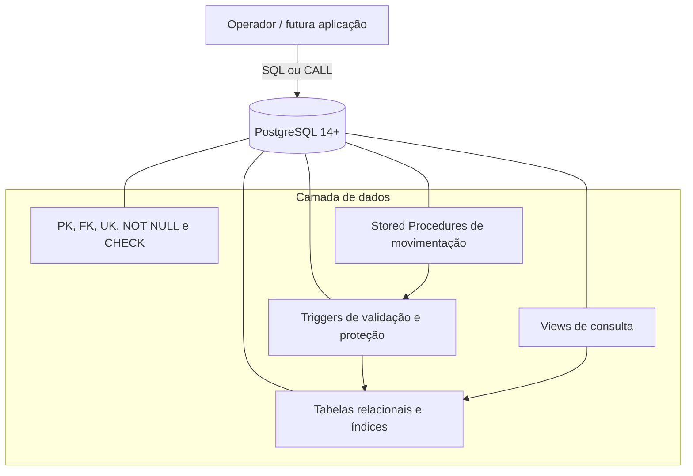

# Controle de Estoque — Depósito de Pizzaria

[](https://www.postgresql.org/)
[](#licen%C3%A7a)

Projeto Integrador de Engenharia de Software — CEUB, Ciclo 2 (2026/2)  
Modalidade: **Opção B — Projeto pessoal**  
Versão documental proposta: **v1.0.0**  
Data-base do cronograma: **26/10/2026 a 23/11/2026**

> **Objetivo deste README:** permitir que outra pessoa clone o repositório, prepare um PostgreSQL vazio, crie os objetos do banco e execute os testes sem depender de explicação oral.

## 1. Visão geral

Pequenos depósitos de pizzarias precisam controlar ingredientes e insumos que possuem condições físicas diferentes de armazenamento, como refrigeração, temperatura ambiente, validade, lote, fornecedor e capacidade dos locais. Um controle feito apenas por anotações ou atualizações isoladas pode permitir saldos negativos, armazenamento incompatível, consumo de lote vencido, divergência de inventário e perda do histórico de operações.

Este projeto implementa a camada de dados de um **Sistema de Controle de Estoque para Depósito de Pizzaria**, usando PostgreSQL 14 ou superior. O banco centraliza integridade referencial, validações operacionais, movimentações, rastreabilidade e consultas de reposição.

### Objetivo geral

Construir e documentar um banco relacional que mantenha os saldos por lote e local de armazenamento, valide regras físicas e operacionais, registre quem realizou cada movimentação e permita corrigir operações confirmadas por estorno auditável.

### Objetivos específicos

- Cadastrar funcionários, produtos, categorias, classes de armazenamento, fornecedores e locais.
- Relacionar classes de produtos aos tipos de locais fisicamente compatíveis.
- Controlar lotes, datas de validade e saldos por combinação lote/local.
- Registrar entradas, transferências, consumo, perdas, ajustes e estornos.
- Proteger capacidade em kg e faixa de temperatura do local.
- Impedir saldo negativo e consumo de lote vencido; permitir descarte como `PERDA`.
- Reter histórico das movimentações confirmadas e disponibilizar alerta de reposição.
- Demonstrar as regras com uma suíte transacional SQL.

### Escopo do MVP

O MVP desta versão é **centrado no banco de dados**. Não existe interface web ou desktop incluída na entrega base. Um protótipo Java com JDBC é atividade opcional e só deve ser iniciado depois de o banco e a documentação estarem estáveis, conforme a janela de reserva do cronograma (19/11/2026).

## 2. Stack e pré-requisitos

| Item | Versão / requisito | Finalidade |
|---|---|---|
| PostgreSQL | 14+ | SGBD e execução de DDL, triggers, procedures e views |
| `psql` | Compatível com o PostgreSQL instalado | Executar scripts e testes pela linha de comando |
| Git | Versão estável atual | Histórico e versionamento |
| GitHub | Repositório remoto | Releases, issues e colaboração |
| Editor SQL | pgAdmin, DBeaver ou VS Code (opcional) | Inspecionar objetos e executar consultas |
| Sistema operacional | Windows, Linux ou macOS | Ambiente de desenvolvimento |

O usuário do banco deve ter permissão para criar tabelas, índices, funções, procedures, triggers e views no banco de desenvolvimento. Para operação real, recomenda-se separar o usuário proprietário do schema do usuário de aplicação e conceder somente as permissões necessárias.

## 3. Arquitetura resumida

A arquitetura é **database-centric**: o PostgreSQL mantém os dados e executa as regras críticas próximas da persistência. Constraints protegem regras locais aos dados; triggers validam condições que dependem de outras tabelas ou do estado da operação; stored procedures agrupam sequências de movimentação em transações; views apresentam informações derivadas.



### Estrutura do repositório

```text
controle-estoque-pizzaria/
├── README.md
├── .env.example
├── .gitignore
├── sql/
│   └── controle_estoque_pizzaria_postgresql.sql
├── tests/
│   ├── README.md
│   └── testes_transacionais.sql
└── docs/
    ├── diagramas/
    │   └── arquitetura_e_dados.md
    ├── adrs/
    │   ├── ADR-001-regras-criticas-no-postgresql.md
    │   ├── ADR-002-estorno-e-imutabilidade.md
    │   └── ADR-003-compatibilidade-fisica.md
    ├── plano_gestao/
    │   └── plano_gerenciamento_projeto.md
    └── requisitos/
        └── matriz_rastreabilidade.md
```

### Inventário de tabelas

**Correção de contagem:** a descrição inicial do projeto menciona 12 tabelas, mas o DDL efetivamente entregue contém **13 tabelas**. A contagem foi conferida diretamente no script. `item_movimentacao` é uma tabela própria e não deve ser omitida da documentação.

1. `funcionario`
2. `categoria_produto`
3. `classe_armazenamento`
4. `tipo_local_armazenamento`
5. `compatibilidade_armazenamento`
6. `produto`
7. `fornecedor`
8. `local_armazenamento`
9. `lote`
10. `estoque`
11. `movimentacao_estoque`
12. `item_movimentacao`
13. `registro_temperatura`

O DER lógico completo, com PKs, FKs, UKs e tipos, está em [`docs/diagramas/arquitetura_e_dados.md`](docs/diagramas/arquitetura_e_dados.md).

## 4. Clonar e preparar o ambiente

### 4.1 Clonar

```bash
git clone <URL-DO-REPOSITORIO>
cd controle-estoque-pizzaria
```

Substitua `<URL-DO-REPOSITORIO>` pela URL HTTPS ou SSH mostrada pelo GitHub.

### 4.2 Conferir ferramentas

```bash
git --version
psql --version
```

A versão do cliente `psql` deve ser compatível com o servidor PostgreSQL 14+. Verifique também se o serviço PostgreSQL está iniciado e se a porta configurada está acessível.

### 4.3 Configurar variáveis de ambiente

Copie o modelo e edite os valores localmente:

```bash
cp .env.example .env
```

O arquivo `.env` contém configurações locais e **não deve ser enviado ao GitHub**. O `.gitignore` já o exclui.

Exemplo de variáveis:

```dotenv
PGHOST=localhost
PGPORT=5432
PGDATABASE=controle_estoque_pizzaria
PGUSER=postgres
PGPASSWORD=troque_esta_senha
```

`psql` não carrega arquivos `.env` automaticamente. Em Linux/macOS, caso o shell seja Bash ou compatível, carregue as variáveis antes dos comandos:

```bash
set -a
source .env
set +a
```

No PowerShell, defina-as na sessão (ou informe host, porta, usuário e banco nos parâmetros de `psql`):

```powershell
$env:PGHOST = "localhost"
$env:PGPORT = "5432"
$env:PGDATABASE = "controle_estoque_pizzaria"
$env:PGUSER = "postgres"
# Para evitar manter senha no histórico, deixe o psql solicitá-la com -W.
```

## 5. Criar o banco e executar o DDL

> **Importante:** o script foi escrito para um banco de desenvolvimento vazio. Ele usa `CREATE TABLE` e demais comandos sem `IF NOT EXISTS`; portanto, não deve ser executado novamente sobre objetos já existentes. Não o execute diretamente em produção.

### 5.1 Criar o banco

Com as variáveis do `.env` carregadas:

```bash
createdb -h "$PGHOST" -p "$PGPORT" -U "$PGUSER" -W "$PGDATABASE"
```

Alternativamente, no PowerShell ou em qualquer terminal, execute `createdb` informando os valores e a senha quando solicitado:

```bash
createdb -h localhost -p 5432 -U postgres -W controle_estoque_pizzaria
```

### 5.2 Executar a estrutura

```bash
psql -h "$PGHOST" -p "$PGPORT" -U "$PGUSER" -d "$PGDATABASE" \
  -v ON_ERROR_STOP=1 -W \
  -f sql/controle_estoque_pizzaria_postgresql.sql
```

No PowerShell:

```powershell
psql -h localhost -p 5432 -U postgres -d controle_estoque_pizzaria -v ON_ERROR_STOP=1 -W -f sql/controle_estoque_pizzaria_postgresql.sql
```

O DDL cria tabelas, constraints, índices, funções, triggers, procedures e a view `vw_alerta_reposicao`. Ao final, a transação de implantação é confirmada com `COMMIT`.

### 5.3 Conferir os objetos criados

Conectado ao banco:

```sql
\dt
\df
\dv
```

Para consultar a view:

```sql
SELECT * FROM vw_alerta_reposicao ORDER BY nome;
```

Observação sobre a view: a definição atual possui um `HAVING` que limita o resultado a produtos cujo saldo disponível está no ponto de reposição ou abaixo dele. Embora o `CASE` também defina `NORMAL`, essa condição não aparece na saída enquanto o `HAVING` permanecer. A documentação registra essa diferença como ajuste conhecido; veja a seção de limitações.

## 6. Executar a suíte de testes transacionais

Com o DDL criado com sucesso, execute:

```bash
psql -h "$PGHOST" -p "$PGPORT" -U "$PGUSER" -d "$PGDATABASE" \
  -v ON_ERROR_STOP=1 -W \
  -f tests/testes_transacionais.sql
```

O script cria dados fictícios dentro de uma transação, verifica cenários positivos e negativos e termina com `ROLLBACK`. Assim, os registros usados nos testes são revertidos e não ficam misturados aos dados de desenvolvimento. A suíte usa blocos `DO` e `RAISE NOTICE` para indicar os resultados esperados.

Cenários incluídos:

- funcionário inativo não cria movimentação;
- produto não é armazenado em tipo de local incompatível;
- tentativa de exceder capacidade do local é bloqueada;
- lote vencido não pode ser consumido, mas pode ser registrado como `PERDA`;
- retirada automática prioriza o lote com validade mais próxima (cenário PVPS);
- constraint impede saldo negativo;
- estorno cria movimentação inversa, marca a original como estornada e impede segundo estorno.

A suíte é transacional e executada manualmente via `psql`; ainda não existe pipeline GitHub Actions ou medição automatizada de cobertura nesta versão. Os testes concorrentes de duas sessões, imutabilidade de itens já confirmados, proteção de inativação com rascunho e validação térmica devem ser acrescentados à bateria em uma próxima iteração. A existência de `FOR UPDATE` no código não substitui um teste concorrente reproduzível.

Mais detalhes: [`tests/README.md`](tests/README.md) e [`docs/requisitos/matriz_rastreabilidade.md`](docs/requisitos/matriz_rastreabilidade.md).

## 7. Regras operacionais importantes

- A movimentação exige funcionário ativo em `INSERT` ou `UPDATE`.
- A inativação do funcionário é bloqueada quando ele possui movimentação em `RASCUNHO`.
- O lote exige `data_validade` quando o produto está configurado com `controla_validade = TRUE`; a constraint exige que um produto que controla validade também seja perecível. Para que todo perecível exija validade, os dados devem ser cadastrados com `controla_validade = TRUE`.
- A gravação/alteração do estoque valida compatibilidade classe/local, faixa térmica e capacidade ponderada em kg, com lock da linha do local.
- `quantidade_atual` não pode ser negativa.
- Lote vencido não pode ser consumido; a perda/descarte é representada pelo tipo `PERDA`.
- Itens ligados a movimentações `CONFIRMADA` ou `ESTORNADA` não podem ser alterados ou excluídos.
- A correção de uma movimentação confirmada deve usar `sp_estornar_movimentacao`; o histórico original permanece.

### Ressalvas de implementação a conhecer

1. A coluna `produto.politica_saida` aceita `PEPS` e `PVPS`, porém a implementação atual de `sp_retirar_estoque` ordena primeiro pela menor validade e usa `recebido_em` como desempate/critério secundário. A procedure não ramifica a ordenação pela configuração `politica_saida`. Portanto, esta versão demonstra PVPS com recebimento como desempate e não uma alternância independente de política por produto.
2. `vw_alerta_reposicao` calcula `CRITICO`, `REPOR` e `NORMAL`, mas o `HAVING` atual omite as linhas `NORMAL`.
3. A obrigatoriedade da validade depende do indicador `controla_validade`, não apenas de `perecivel`.
4. A suíte atual não simula concorrência real entre duas sessões. O uso de locks foi implementado, mas deve ser comprovado também com testes concorrentes.
5. `peso_equivalente_kg` deve ser cadastrado com conversão operacional correta para cada unidade de estoque; erro de conversão compromete a validação física da capacidade.

Essas ressalvas são registradas para evitar que o README prometa comportamento ainda não coberto integralmente pelo SQL.

## 8. Política Git, branches e commits

### Branches

- `main`: linha estável; somente conteúdo revisado e executável.
- `feature/<assunto>`: nova funcionalidade ou melhoria, por exemplo `feature/testes-concorrencia`.
- `fix/<assunto>`: correção, por exemplo `fix/alerta-reposicao-normal`.
- `docs/<assunto>`: documentação, por exemplo `docs/adr-001`.

Em trabalho individual, pull requests podem ser usados como revisão própria e trilha de decisão; não é necessário inventar colaboradores. Não enviar senhas, dumps com dados pessoais ou arquivos `.env`.

### Convenção de commits

Usar mensagens curtas no padrão Conventional Commits:

```text
docs(readme): documenta instalação e execução
db(schema): adiciona restrição de validade
db(procedure): corrige ordenação PVPS/PEPS
test(sql): cobre inativação com rascunho
fix(trigger): bloqueia armazenamento incompatível
```

Commits pequenos devem representar uma mudança coerente. Atualizar diagrama, matriz de rastreabilidade e ADR sempre que uma decisão estrutural for alterada.

## 9. Release e versionamento semântico

O projeto adota SemVer `MAJOR.MINOR.PATCH`:

- `MAJOR`: mudança incompatível de schema ou contrato de procedure;
- `MINOR`: funcionalidade compatível adicionada;
- `PATCH`: correção compatível ou ajuste documental.

A tag `v1.0.0` deve ser criada **somente depois** de: (1) DDL executado em banco vazio; (2) suíte transacional concluída sem falha inesperada; (3) diagramas e ADRs revisados; (4) README validado por uma pessoa que não participou da implementação; (5) limitações conhecidas registradas.

```bash
git checkout main
git pull origin main
git tag -a v1.0.0 -m "Release acadêmica 1.0.0 - Controle de Estoque Pizzaria"
git push origin v1.0.0
```

Depois, publicar uma GitHub Release baseada na tag, anexando notas de versão, scripts e limitações conhecidas. A publicação da release é uma atividade de entrega; não deve ser declarada concluída apenas porque a tag foi criada localmente.

## 10. Backup, rollback e recuperação

### Antes de qualquer alteração estrutural relevante

Gerar backup lógico:

```bash
pg_dump -h "$PGHOST" -p "$PGPORT" -U "$PGUSER" -W \
  -d "$PGDATABASE" -F c -f backup_controle_estoque_pre_mudanca.dump
```

Armazenar o backup fora do repositório, com acesso restrito. Não versionar dumps de produção.

### Recuperar em banco separado

```bash
createdb -h "$PGHOST" -p "$PGPORT" -U "$PGUSER" -W controle_estoque_recuperacao
pg_restore -h "$PGHOST" -p "$PGPORT" -U "$PGUSER" -W \
  -d controle_estoque_recuperacao backup_controle_estoque_pre_mudanca.dump
```

Validar integridade, contagens e consultas no banco recuperado antes de redirecionar qualquer aplicação para ele. Em produção, a troca de conexão deve ser aprovada pelo responsável operacional.

### Quando uma execução falhar

- Se o erro ocorrer dentro de uma transação ainda aberta, usar `ROLLBACK` ou encerrar a sessão para descartar a transação abortada.
- O DDL inicial deve ser instalado em banco vazio. Como não é um script de migração idempotente e não possui script inverso, não tente “reexecutar por cima”. Em ambiente de desenvolvimento descartável, recrie o banco vazio; em ambiente que contenha dados, restaure um backup validado ou aplique uma migração corretiva revisada.
- Para corrigir uma operação de negócio já confirmada, usar `sp_estornar_movimentacao`, não `DELETE` nem edição manual dos itens históricos.
- Após a recuperação, executar novamente os testes e registrar incidente, causa, decisão e commit correspondente.

## 11. Limitações e evolução planejada

- Adicionar testes automatizados de concorrência com duas sessões e ensaios de deadlock/ordem de locks.
- Cobrir explicitamente imutabilidade, proteção de funcionário com rascunho e limites de temperatura.
- Decidir e implementar o comportamento de seleção PEPS/PVPS baseado em `produto.politica_saida`.
- Revisar a view para decidir se deve retornar também produtos em situação `NORMAL`.
- Definir grants/revokes para restringir DML direto em tabelas críticas e priorizar o uso das procedures.
- Considerar versionamento de migrações (por exemplo, diretório `sql/migrations/`) antes de evoluções posteriores.
- Avaliar protótipo Java/JDBC somente após cumprir a definição de pronto do banco.

## 12. Documentação complementar

- [Arquitetura, modelo conceitual, DER lógico e sequência de retirada](docs/diagramas/arquitetura_e_dados.md)
- [ADR-001 — Regras críticas no PostgreSQL](docs/adrs/ADR-001-regras-criticas-no-postgresql.md)
- [ADR-002 — Estorno e imutabilidade](docs/adrs/ADR-002-estorno-e-imutabilidade.md)
- [ADR-003 — Compatibilidade física](docs/adrs/ADR-003-compatibilidade-fisica.md)
- [Plano de gerenciamento do projeto](docs/plano_gestao/plano_gerenciamento_projeto.md)
- [Matriz de rastreabilidade requisito–implementação–teste](docs/requisitos/matriz_rastreabilidade.md)

## 13. Referências acadêmicas e materiais de apoio

- SOMMERVILLE, Ian. *Engenharia de software*. 10. ed. São Paulo: Pearson, 2018. Capítulos utilizados conforme a orientação didática do CEUB: 2 (processos de software), 3 (desenvolvimento ágil), 4 (engenharia de requisitos), 5 (modelagem), 6 (projeto de arquitetura), 7 (projeto e implementação), 8 (teste de software), 9 (evolução), 22 (gerenciamento de projetos), 23 (planejamento de projeto) e 25 (gerenciamento de configuração).
- PRESSMAN, Roger S.; MAXIM, Bruce R. *Engenharia de software: uma abordagem profissional*. 9. ed. Porto Alegre: AMGH, 2021.
- CEUB. *Projeto Integrador – Ciclo 2 (out.–nov.–dez. 2026): Método de Avaliação*. Engenharia de Software, Ciência da Computação, Turma B, 2026/2.
- CEUB. *Caderno de Dinâmicas e Modelos de Entrega*. Aula 8, versão 2.0, 2026.
- CEUB. *Mapa Mental — Gerenciamento de Projetos*. Aula 10, 2026.
- Arquivo de cronograma do projeto: `Cronograma_Banco_de_Dados(1).xlsx` (linha de base de 26/10/2026 a 23/11/2026; abas Cronograma, Kanban e Plano).

## Licença

Material acadêmico de projeto pessoal. Defina uma licença de código aberto (por exemplo, MIT) somente se houver intenção de permitir reutilização pública e se não houver restrição institucional ou de terceiros. Até essa decisão, todos os direitos permanecem reservados ao autor do repositório.
