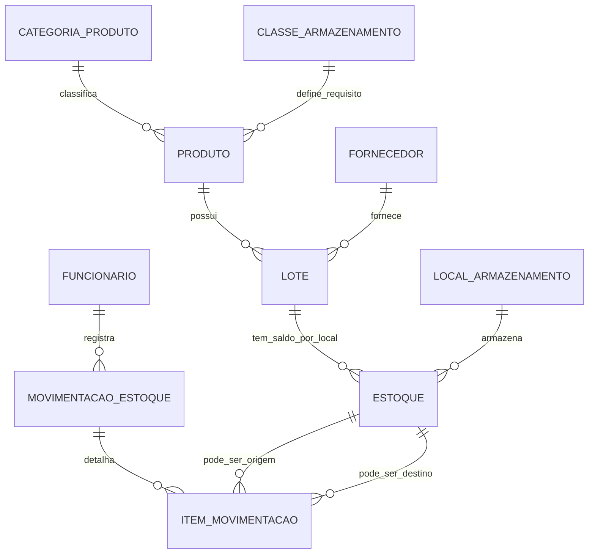
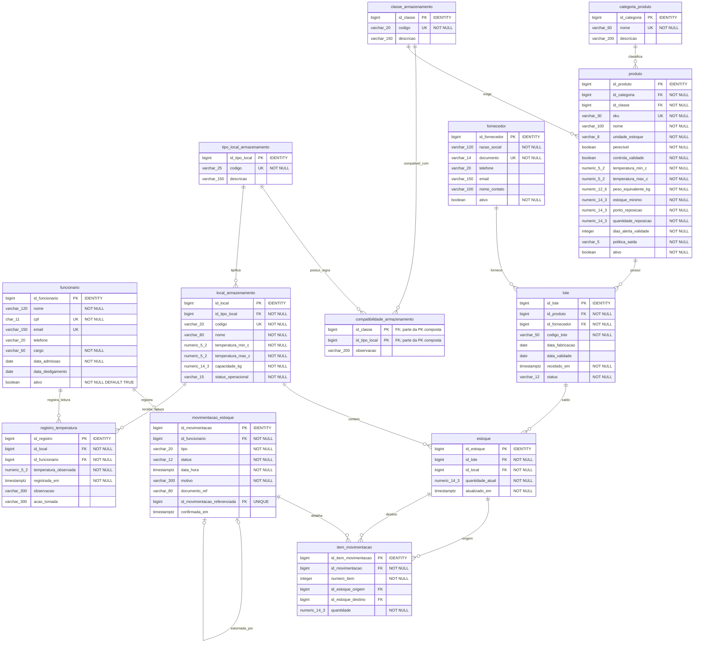

# Arquitetura e Dados

## 1. Visão arquitetural

O sistema adota uma arquitetura centrada no PostgreSQL 14+. As tabelas representam o domínio do depósito; constraints protegem condições declarativas; triggers validam relações entre dados e estado da operação; procedures coordenam alterações de saldo; e views disponibilizam consultas derivadas.

A camada de aplicação (ou operador via cliente SQL) é consumidora do contrato do banco. Para preservar regras críticas, o ambiente de implantação deve restringir permissões de escrita direta e conceder uso controlado das procedures. Essa política de privilégios é uma recomendação operacional; `GRANT`/`REVOKE` ainda não está incluído no script-base.

## 2. Modelo conceitual — 9 entidades principais

As nove entidades centrais são `FUNCIONARIO`, `CATEGORIA_PRODUTO`, `CLASSE_ARMAZENAMENTO`, `PRODUTO`, `FORNECEDOR`, `LOTE`, `LOCAL_ARMAZENAMENTO`, `ESTOQUE` e `MOVIMENTACAO_ESTOQUE`. O modelo abaixo destaca suas associações. As tabelas `TIPO_LOCAL_ARMAZENAMENTO`, `COMPATIBILIDADE_ARMAZENAMENTO`, `ITEM_MOVIMENTACAO` e `REGISTRO_TEMPERATURA` complementam o núcleo como referência, associativa ou suporte operacional.



### Interpretação das cardinalidades

| Relação | Cardinalidade | Regra de domínio |
|---|---|---|
| Funcionário → movimentação | 1:N | Um funcionário registra várias movimentações; cada movimentação tem um funcionário responsável. |
| Categoria → produto | 1:N | Uma categoria classifica vários produtos; cada produto pertence a uma categoria. |
| Classe → produto | 1:N | Uma classe de armazenamento pode ser exigida por vários produtos. |
| Produto → lote | 1:N | Um produto pode possuir diversos lotes. |
| Fornecedor → lote | 1:N | Um fornecedor pode fornecer diversos lotes; cada lote referencia um fornecedor. |
| Lote → estoque | 1:N | O mesmo lote pode ter saldos separados em diferentes locais. |
| Local → estoque | 1:N | Um local pode conter saldos de vários lotes. |
| Movimentação → item | 1:N | Uma movimentação possui um ou mais itens detalhando seus efeitos. |
| Estoque ↔ item | N:N conceitual | Uma movimentação pode afetar várias posições de estoque; `ITEM_MOVIMENTACAO` registra origem e destino. |

**Entidades complementares:** tipo de local e classe de armazenamento possuem relação N:N resolvida por `COMPATIBILIDADE_ARMAZENAMENTO`; registro de temperatura associa um local a uma leitura realizada por funcionário.

## 3. DER lógico — todas as 13 tabelas

> **Contagem conferida no DDL:** são 13 tabelas, embora a descrição resumida do projeto mencione 12. Todas as tabelas existentes no script estão representadas abaixo.



**Convenção de tipos no Mermaid:** para manter os nomes dos tipos em tokens compatíveis com o diagrama, `varchar_120` representa `VARCHAR(120)`, `char_11` representa `CHAR(11)`, `numeric_5_2` representa `NUMERIC(5,2)` e `numeric_14_3` representa `NUMERIC(14,3)`. `bigint`, `integer`, `boolean`, `date` e `timestamptz` correspondem aos tipos PostgreSQL com o mesmo nome. A definição exata continua sendo a do DDL em `sql/controle_estoque_pizzaria_postgresql.sql`.

### Chaves únicas adicionais e regras de domínio

As chaves marcadas no diagrama devem ser interpretadas em conjunto com estas constraints do DDL:

| Tabela | UK / constraint composta | Regra |
|---|---|---|
| `compatibilidade_armazenamento` | PK (`id_classe`, `id_tipo_local`) | Impede duplicar o mesmo par de compatibilidade. |
| `lote` | UK (`id_produto`, `codigo_lote`) | Um código de lote é único dentro do produto. |
| `estoque` | UK (`id_lote`, `id_local`) | Um único saldo por combinação lote/local. |
| `item_movimentacao` | UK (`id_movimentacao`, `numero_item`) | Número do item não se repete dentro da movimentação. |
| `produto` | `sku` UK | Identificador comercial do produto. |
| `movimentacao_estoque` | `id_movimentacao_referenciada` UK | Uma movimentação original não recebe dois estornos associados. |

Outras constraints: saldo não negativo; quantidade de item maior que zero; origem e destino não podem ser simultaneamente nulos nem apontar para a mesma posição; unidades e estados limitados a domínios aceitos; faixas térmicas coerentes; capacidade e peso equivalentes positivos; datas de fabricação/validade coerentes.

### Dicionário resumido por tabela

| Tabela | Responsabilidade |
|---|---|
| `funcionario` | Identidade, cargo, vínculo e estado ativo do operador. |
| `categoria_produto` | Agrupa produtos por categoria. |
| `classe_armazenamento` | Identifica a condição física/térmica exigida pelo produto. |
| `tipo_local_armazenamento` | Classifica a natureza do local físico. |
| `compatibilidade_armazenamento` | Resolve a relação N:N entre classe de produto e tipo de local. |
| `produto` | Cadastro do item, unidade, conversão para kg, faixas térmicas, validade e parâmetros de reposição. |
| `fornecedor` | Cadastro da origem de fornecimento dos lotes. |
| `local_armazenamento` | Capacidade, tipo, condição térmica e estado operacional do espaço. |
| `lote` | Rastreia fornecedor, fabricação, validade e estado do lote. |
| `estoque` | Saldo quantitativo de um lote em um local específico. |
| `movimentacao_estoque` | Cabeçalho e estado de cada operação, responsável, motivo e vínculo de estorno. |
| `item_movimentacao` | Itens de origem/destino e quantidades movimentadas. |
| `registro_temperatura` | Histórico de leituras de temperatura por local e funcionário. |

## 4. Fluxo de `sp_retirar_estoque` — PVPS/PEPS e locks

```mermaid
sequenceDiagram
    autonumber
    actor Operador
    participant DB as PostgreSQL
    participant Proc as sp_retirar_estoque
    participant Func as funcionario
    participant Prod as produto
    participant Est as estoque / lote / local
    participant Trg as Triggers e constraints

    Operador->>DB: CALL sp_retirar_estoque(produto, quantidade, funcionário, motivo)
    DB->>Proc: Inicia procedure na transação atual
    Proc->>Proc: Valida quantidade > 0
    Proc->>Func: SELECT ativo ... FOR KEY SHARE
    Func-->>Proc: Funcionário ativo?
    Proc->>Prod: Verifica produto ativo
    Prod-->>Proc: Produto disponível?
    Proc->>DB: INSERT movimentacao_estoque (RASCUNHO)
    DB->>Trg: trg_mov_funcionario_ativo (BEFORE INSERT)
    Trg-->>DB: Permite somente funcionário ativo

    loop Para cada saldo elegível, ordenado por validade e recebimento
      Proc->>Est: SELECT saldos > 0, lote LIBERADO, não vencido e local ATIVO
      Note over Proc,Est: ORDER BY data_validade ASC NULLS LAST, recebido_em ASC, id_estoque ASC
      Proc->>Est: FOR UPDATE OF estoque
      Est-->>Proc: Linha bloqueada e saldo atual
      Proc->>Est: UPDATE estoque = estoque - menor(saldo, restante)
      Est->>Trg: trg_estoque_compatibilidade_capacidade (BEFORE UPDATE)
      Trg->>Est: Bloqueia linha do local com FOR UPDATE; valida classe, temperatura e kg
      Est-->>Proc: Saldo validado
      Proc->>DB: INSERT item_movimentacao (origem, quantidade)
      DB->>Trg: trg_item_validar_regras + trg_item_proteger_confirmado
      Trg-->>DB: Valida tipo, lote e estado da movimentação
      Proc->>Proc: Atualiza quantidade restante
    end

    alt Quantidade solicitada não foi atendida
      Proc-->>DB: RAISE EXCEPTION (saldo insuficiente/indisponível)
      DB-->>Operador: Erro; transação da chamada deve ser revertida
    else Quantidade atendida
      Proc->>DB: UPDATE movimentação para CONFIRMADA
      DB->>Trg: trg_mov_funcionario_ativo (BEFORE UPDATE)
      Trg-->>DB: Revalida funcionário ativo
      DB-->>Operador: Movimentação confirmada e ID retornado
    end
```

### Leitura do algoritmo implementado

A rotina filtra lotes `LIBERADO`, não vencidos, com saldo positivo em local `ATIVO`. O `FOR UPDATE OF e` bloqueia as linhas de saldo selecionadas para que outra baixa concorrente não consuma simultaneamente o mesmo saldo sem aguardar a atualização. Cada retirada reduz o saldo e cria um item de movimentação. Se a quantidade total for insuficiente, a exceção interrompe a chamada e a transação deve ser revertida.

**Precisão sobre PVPS/PEPS:** no código atual, a ordenação efetiva é `data_validade ASC NULLS LAST`, depois `recebido_em ASC` e `id_estoque`. Isso prioriza validade mais próxima (PVPS) e utiliza o recebimento como desempate/critério secundário, inclusive para lotes sem validade. Apesar de `produto.politica_saida` aceitar `PEPS` ou `PVPS`, a procedure atual não lê esse campo para escolher entre dois `ORDER BY` distintos. Uma versão futura deve implementar essa ramificação se a política configurada por produto for requisito de aceite.

## 5. Regras aplicadas no PostgreSQL

| Regra | Implementação principal | Efeito esperado |
|---|---|---|
| Funcionário ativo | `trg_mov_funcionario_ativo` / `fn_validar_funcionario_ativo` | Impede inserir ou atualizar movimentação com funcionário inativo. |
| Proteção de funcionário com rascunho | `trg_funcionario_inativacao` | Impede inativação enquanto houver movimentação `RASCUNHO` vinculada. |
| Validade obrigatória | `trg_lote_validade` / `fn_validar_lote` | Exige validade quando `produto.controla_validade = TRUE`. |
| Compatibilidade classe/local | `trg_estoque_compatibilidade_capacidade` | Confirma que classe do produto é compatível com o tipo do local. |
| Temperatura | `fn_validar_estoque_local_capacidade` | Exige que a faixa operacional inteira do local esteja dentro da faixa aceita pelo produto. |
| Capacidade | `fn_validar_estoque_local_capacidade` | Converte saldo para kg por `peso_equivalente_kg`, soma ocupação e bloqueia excedente. |
| Concorrência no local | `SELECT ... FOR UPDATE` na linha de `local_armazenamento` | Serializa alterações de saldo que disputam a capacidade do mesmo local. |
| Lote vencido | `trg_item_validar_regras` | Bloqueia tipo `CONSUMO` para lote vencido; `PERDA` é aceito para descarte. |
| Imutabilidade de item | `trg_item_proteger_confirmado` | Bloqueia INSERT/UPDATE/DELETE de itens quando cabeçalho está `CONFIRMADA` ou `ESTORNADA`. |
| Saldo não negativo | `ck_estoque_quantidade` e rotinas com locks | Impede valores negativos no registro do estoque. |
| Estorno | `sp_estornar_movimentacao` | Cria cabeçalho e itens inversos, sem apagar a operação original. |

## 6. Atributos de qualidade apoiados pela arquitetura

### Integridade

PK, FK, UK, `NOT NULL` e `CHECK` protegem identidade, relacionamentos, unicidade e domínios. Triggers tratam regras que exigem consulta a outras entidades ou consideração do tipo/estado da movimentação. As procedures agrupam alterações que precisam manter cabeçalho, itens e saldos coerentes.

### Confiabilidade

A execução transacional faz com que exceções interrompam a operação e permitam rollback, evitando confirmar parcialmente uma retirada. A view de reposição deriva o saldo a partir das tabelas operacionais, evitando manter um indicador paralelo desatualizado. A confiabilidade ainda depende de backup, controle de privilégios, testes e operação correta do ambiente.

### Concorrência

`FOR UPDATE` bloqueia linhas de saldo durante retirada e a linha do local durante cálculo de capacidade. `FOR KEY SHARE` protege leituras referenciais importantes, como funcionário e movimentação. Esses locks reduzem condições de corrida, mas podem introduzir espera e deadlocks quando transações concorrentes adquirem locks em ordens diferentes. A procedure de transferência deve ser exercitada com duas sessões e, idealmente, padronizada para bloquear posições em ordem de ID.

### Auditabilidade

O cabeçalho da movimentação retém funcionário, data/hora, motivo, tipo, status e eventual referência de estorno. Os itens documentam as posições de origem/destino e quantidades. Movimentações confirmadas não devem ser apagadas para corrigir erros: o estorno inverso preserva a trilha histórica. `registro_temperatura` acrescenta evidência de monitoramento ambiental.

## 7. Limitações e verificações adicionais

- A suite SQL atual cobre funcionário inativo, incompatibilidade de local, capacidade excedida, lote vencido/`PERDA`, retirada PVPS, saldo negativo e estorno duplicado.
- A suite ainda não demonstra concorrência simultânea de duas sessões nem deadlock real; estes cenários exigem teste de integração concorrente.
- A imutabilidade de itens confirmados, inativação com rascunhos e faixa térmica têm implementação no DDL, mas ainda precisam de casos explícitos na suite.
- A view inclui cálculo `NORMAL`, mas o `HAVING` atual exibe apenas produtos até o ponto de reposição.
- A validade é exigida quando `controla_validade` está ativo; o cadastro precisa manter esse indicador coerente para todos os perecíveis sujeitos a validade.
- A coluna `politica_saida` não altera a ordenação atual de `sp_retirar_estoque`.
- A conversão `peso_equivalente_kg` precisa ser validada com dados reais e unidade correta.

## 8. Referências de fundamentação

- SOMMERVILLE, Ian. *Engenharia de software*. 10. ed. São Paulo: Pearson, 2018. Cap. 5 — Modelagem; cap. 6 — Projeto de arquitetura; cap. 7 — Projeto e implementação; cap. 8 — Teste de software.
- PRESSMAN, Roger S.; MAXIM, Bruce R. *Engenharia de software: uma abordagem profissional*. 9. ed. Porto Alegre: AMGH, 2021.
- CEUB. *Caderno de Dinâmicas e Modelos de Entrega*. Aula 8, ficha 6 (Registro de decisão de arquitetura) e quadro de referências, 2026.
